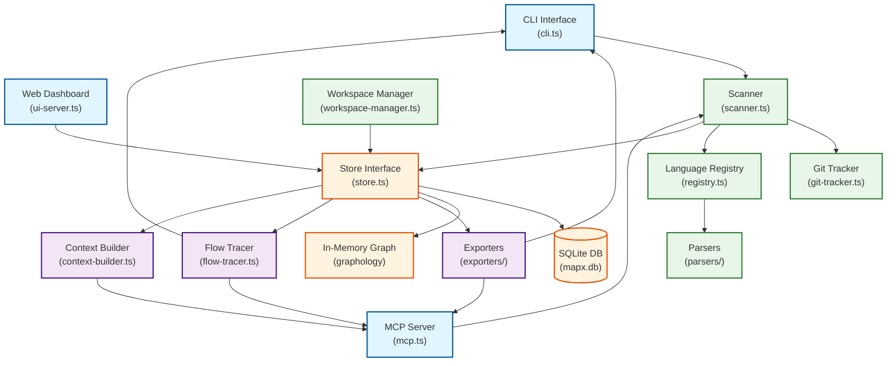

<p align="center">

</p>

<h1 align="center">MapX</h1>

<p align="center">
<a href="https://npmjs.org/package/@mgamil/mapx">

</a>
<a href="https://github.com/MohamedGamil/mapx/actions/workflows/ci.yml">

</a>
<a href="https://coveralls.io/github/MohamedGamil/MapX">

</a>
<a href="https://npmjs.org/package/@mgamil/mapx">

</a>
</p>

<br>
<br>

<p align="center">
<strong>Local code graph memory for LLMs.</strong><br>
<em>Scan your codebase once — instantly query symbols, trace dependencies, analyze impact, check architecture rules and generate structured summaries without re-reading files.</em>
</p>

<br>
<br>

## Why MapX?

* **One local index of your code.** Symbols, imports, calls, inheritance, routes and HTTP calls from 23 languages, kept in SQLite under `.mapx/`. Nothing leaves your machine.
* **Answers instead of file reads.** Agents ask for signatures, callers, dependencies and blast radius through 39 MCP tools, which costs far fewer tokens than reading the files (about 85% less in the [benchmark](docs/benchmarking.md)).
* **Fast and incremental.** A pool of parse workers indexes large repositories, and `mapx sync` re-parses only what git or the content hashes say changed.
* **Architecture rules in CI.** Declare layers in `.mapx/architecture.jsonc` and `mapx check` fails the build on a forbidden dependency, with SARIF, GitHub, GitLab and JUnit reports.

<br>

## Table of Contents

<details>
<summary>Click to expand</summary>

- [Features](#features)
- [Installation](#installation)
  - [From npm (Global Installation)](#from-npm-global-installation)
  - [Zero Installation (via npx)](#zero-installation-via-npx)
  - [Pre-built binary](#pre-built-binary)
  - [From source](#from-source)
- [Quick start](#quick-start)
- [Commands](#commands)
- [Architecture rules](#architecture-rules)
- [Token Consumption Benchmarks](#token-consumption-benchmarks)
- [MCP Integration](#mcp-integration)
  - [Claude Desktop](#claude-desktop-claude_desktop_configjson)
  - [Cursor / VS Code](#cursor--vs-code-cursormcpjson)
  - [Available MCP tools (39 total)](#available-mcp-tools-39-total)
- [Programmatic Usage](#programmatic-usage)
- [Supported Languages](#supported-languages)
- [Agentic Integration](#agentic-integration)
- [Storage](#storage)
- [Architecture](#architecture)
- [Documentation](#documentation)
- [Development](#development)
  - [npm script shortcuts](#npm-script-shortcuts)
  - [Makefile shortcuts](#makefile-shortcuts)
  - [Building binaries](#building-binaries)
- [License](#license)

</details>

<br>
<hr>

## Features

| Feature | What you get | Docs |
|---------|--------------|------|
| **Multi-language indexing** | 23 languages with tree-sitter grammars, all bundled (PHP, JavaScript, TypeScript, Vue, Svelte, Python, Go, Rust, Java, C#, Ruby, C, C++, Swift, Kotlin, Scala, Dart, Lua, Elixir, Zig, Bash, Fish, Pascal), plus index-only links in Markdown, HTML, CSS, JSON and YAML. Classes, functions, methods, interfaces, traits, enums, decorators and doc tags; import, call, inheritance and instantiation edges resolved through each language's own module rules and path aliases. | [Supported languages](docs/getting-started.md#supported-languages), [Adding languages](docs/adding-languages.md) |
| **Frameworks and routes** | 22 framework detectors (Laravel, Symfony, Express, NestJS, Next.js, Django, FastAPI, Rails, Spring, ASP.NET, Flutter, Vue Router and more) extract routes with their middleware, names and lines, and hooks. Laravel routes follow how each route file is mounted. Vue components get render, navigate and store edges. | [Framework integration](docs/framework-integration.md), [`mapx routes`](docs/cli-reference.md#mapx-routes) |
| **HTTP pairing** | Frontend HTTP calls (axios, `fetch`, client instances and factories) are resolved to URLs, with base URLs and `.env` values, and paired with the backend route they reach, across repositories. `mapx routes --clients --unmatched` lists the calls that reach no route. | [HTTP pairing](docs/framework-integration.md#http-pairing) |
| **Fast incremental scans** | A parse worker pool sized from the work, the CPUs and the free memory, with grammars loaded per language on demand. `mapx sync` re-parses only changed files (git blobs or content hashes) and the files whose imports they affect, giving the index a full scan gives. Interrupted scans resume. | [Parallel parsing](docs/configuration.md#parallel-parsing), [`mapx scan`](docs/cli-reference.md#mapx-scan) |
| **Querying and flow** | Symbol search with globs and fuzzy suggestions, callers and callees, data-flow traces, sources and sinks, change impact with risk scoring, coupling metrics and a file's edges. | [CLI reference](docs/cli-reference.md) |
| **External references** | Every reference to code outside the workspace is recorded with its package and whether that package is a direct or transitive, production or dev-only dependency: npm (package.json and the npm, pnpm and yarn lockfiles), Composer (composer.json and composer.lock), pip, Poetry and uv (pyproject.toml, requirements files, poetry.lock, uv.lock) and Go modules (go.mod, go.sum, go.work). Standard-library modules are classified as built-ins, and ambient access (`process.env`, `window`, `$_GET`, `os.environ`, `os.Getenv`) is recorded too. | [External dependencies](docs/architecture-rules.md#external-dependencies-packages-built-ins-ambient-access) |
| **Architecture analysis** | Codebase profile and archetype, file roles, Leiden clusters, PageRank, a dependency structure matrix and smells (cycles, hubs, unstable dependencies, layer violations). | [Architecture](docs/architecture.md#smart-architecture-classification-subsystem), [`mapx arch`](docs/cli-reference.md#mapx-arch) |
| **Architecture rules** | Layers and allow rules in `.mapx/architecture.jsonc`, checked by `mapx check` with exit codes for CI, six report formats, baselines, a `--compare` ratchet and `--since <git-ref>` for changed files only. Selectors cover paths, names, roles, clusters, decorators, type hierarchy and members, packages, built-ins and ambient access. `mapx arch init` proposes a configuration from 20 presets or your code, and `mapx arch graph` draws the layer graph. The rules add their own smells. | [Architecture rules](docs/architecture-rules.md), [below](#architecture-rules) |
| **Web dashboard** | `mapx ui` opens an interactive graph with Workspace, Symbols, Routes and Hooks, HTTP Calls, Architecture, Context, Metrics, Configuration and Tool Call Log tabs, in light and dark themes. The Architecture tab's Layer rules view shows the rules: health tiles, a layer diagram and DSM that drill down to `file:line` dependencies, and filterable findings. | [`mapx ui`](docs/cli-reference.md#mapx-ui) |
| **MCP server** | 39 tools for Claude, Cursor, VS Code, opencode and any MCP client, over stdio or SSE, including six architecture-rules tools (`mapx_arch_allowed` is a pre-flight check before adding an import). | [MCP integration](docs/mcp-integration.md) |
| **Workspaces and multi-repo** | Register submodules, nested repos, monorepo packages, VS Code workspace folders and sibling repos. Scans cover every registered repo, cross-repo edges (HTTP calls included) are tracked, and `status --all`, `export --all`, `deps --cross-repo` and the dashboard's repo switcher work across them. | [`mapx workspaces`](docs/cli-reference.md#mapx-workspaces), [Multi-repo setup](docs/configuration.md#multi-repo-setup) |
| **Agent integration** | `mapx init` writes `AGENTS.md` and the MCP configuration of the agent tools it detects; `mapx agents generate` writes instructions for Claude, Cursor, Copilot, Windsurf, Cline, Aider, Gemini, Continue and Zed. | [Agentic integration](#agentic-integration), [Agent best practices](docs/agent-best-practices.md) |
| **Exports** | Token-budgeted LLM summary, JSON, GraphViz DOT (cluster view), SVG (no Graphviz needed) and TOON. | [`mapx export`](docs/cli-reference.md#mapx-export) |
| **CLI logo** | `mapx init`, `scan` and `sync` open with the MapX logo in a terminal; never in pipes, CI or MCP, and `MAPX_NO_BANNER=1` turns it off. | [CLI reference](docs/cli-reference.md#mapx-init) |

---

## Installation

### From npm (Global Installation)

Install MapX globally (recommended):

```bash
npm install -g @mgamil/mapx
```

### Zero Installation (via npx)

Run MapX directly without installing it globally:

```bash
# Initialize project
npx @mgamil/mapx init

# Scan files
npx @mgamil/mapx scan
```

### Pre-built binary

Download the latest release for your platform from the [Releases](../../releases) page and place it on your `PATH`:

```bash
# Linux x86_64
curl -fsSL https://github.com/MohamedGamil/mapx/releases/latest/download/mapx-linux-x64-installer.sh | sh

# macOS Apple Silicon
curl -fsSL https://github.com/MohamedGamil/mapx/releases/latest/download/mapx-darwin-arm64-installer.sh | sh
```

Or extract the archive manually:

```bash
tar xzf mapx-<version>-linux-x64.tar.gz
cd mapx-<version>
./install.sh --local          # installs to ~/.local/bin (no sudo)
./install.sh --system         # installs to /usr/local/bin (needs sudo)
```

### From source

Requires [Node.js](https://nodejs.org/) ≥ 20 or [Bun](https://bun.sh/).

```bash
git clone https://github.com/MohamedGamil/mapx.git
cd mapx
npm install
npx tsx src/main.ts --help
```

---

## Quick start

> [!TIP]
> If using the zero-installation method, replace `mapx` with `npx @mgamil/mapx` in the commands below (e.g. `npx @mgamil/mapx init`, `npx @mgamil/mapx scan`).

This creates a two-file sample project in a new folder and runs MapX on it. To try your own code, `cd` into it and start at `mapx init`.

```bash
mkdir mapx-demo && cd mapx-demo
mkdir -p src/domain src/http
cat > src/domain/user-service.ts <<'EOF'
export class UserService {
  find(id: string) {
    return { id };
  }
}

export function findUser(id: string) {
  return new UserService().find(id);
}
EOF
cat > src/http/users-controller.ts <<'EOF'
import { findUser } from '../domain/user-service';

export function handleRequest(id: string) {
  return findUser(id);
}
EOF

# 1. Initialise MapX (creates .mapx/ and AGENTS.md) and build the index
mapx init
mapx scan

# 2. Ask the graph
mapx export                              # token-efficient summary to paste into an LLM
mapx query UserService                   # find a symbol
mapx deps src/http/users-controller.ts   # a file's dependencies and dependants
mapx callers findUser                    # who calls a function
mapx impact UserService                  # blast radius before a change

# 3. Architecture rules: propose layers, then check them (exit 0: no violations)
mapx arch init --write --baseline
mapx check

# 4. After editing files: re-index only what changed
mapx sync
```

Then run `mapx ui` for the dashboard, or `mapx serve` to [connect an agent](#mcp-integration).

All commands accept a target directory via a positional argument, `--dir`, or `-d`:

```bash
mapx scan /path/to/project
mapx query "MyClass" --dir /path/to/project
mapx -d /path/to/project export
```

---

## Commands

| Command | Description |
|---------|-------------|
| `mapx init [path]` | Initialise mapx; create `.mapx/`, `AGENTS.md`, auto-detect agent tools, generate MCP configs, discover monorepo packages & nested repos |
| `mapx uninit [path]` | Remove mapx; delete `.mapx/`, reverse LLM integration changes, clean MCP configs |
| `mapx scan [path]` | Full scan of every registered repo (`--repo` for one, `--force` to re-parse every file, `--no-parallel` for one thread) |
| `mapx sync [path]` | Incremental scan (alias `mapx update`): only re-parses changed files and the files they affect |
| `mapx status [path]` | Show graph metrics, language breakdown, PageRank rankings, git changes (`--all` per repo) |
| `mapx query <term>` | Search symbols by name — supports glob patterns (`*Service`, `get*`), `Class::method` / `Class.method`, and fuzzy suggestions |
| `mapx search <term>` | Advanced symbol search with `--kind`, `--file`, `--exact`, `--limit`, `--format` filters and auto-expand |
| `mapx node <symbol>` | Inspect a symbol with metadata, `--source`, `--format json`, and `--include-members` to list class/interface members |
| `mapx files` | List and filter files with `--path` (prefix or glob), `--lang`, `--sort`, `--limit` |
| `mapx deps <file>` | Show dependencies and reverse-dependencies (glob, partial name; `--cross-repo`) |
| `mapx callers <symbol>` / `mapx callees <symbol>` | Direct and nested callers or callees (with fuzzy fallback) |
| `mapx trace [symbol-or-file]` | Trace data flow paths from a symbol or file |
| `mapx impact <symbol>` | Change impact analysis — blast radius and risk scoring |
| `mapx sources` / `mapx sinks` | Entry points (data sources) and terminal consumers (data sinks) |
| `mapx context <task>` | Generate task-specific workspace context within a token budget |
| `mapx metrics` | Files ranked by coupling: in/out/total degree, instability and PageRank (`--top`, `--exclude`, `--format json`) |
| `mapx edges [file]` | Incoming and outgoing edges of a file (`--direction`, `--type`, `--verified-only`, `--format json`) |
| `mapx routes` | Routes from all detected frameworks; `--clients [--unmatched]` lists frontend HTTP calls and the route each reaches |
| `mapx hooks` | Hooks from all detected frameworks |
| `mapx clusters` | Detected code clusters/modules (`--source layer\|community\|namespace\|directory`) |
| `mapx profile` / `mapx explain <file>` / `mapx layers` | Codebase profile, a file's role classification, files grouped by role |
| `mapx arch` | Architecture report: profile, layers, smells and DSM (`--smells`, `--dsm`, `--violations`) |
| `mapx check` | Check `.mapx/architecture.jsonc` against the index, for CI ([exit codes](docs/architecture-rules.md#exit-codes)) |
| `mapx arch init` | Propose `.mapx/architecture.jsonc` from roles, clusters, the framework or a preset (`--write`, `--baseline`) |
| `mapx arch validate-config` | Validate the architecture configuration without an index |
| `mapx arch layers\|which\|unassigned\|deps\|unused\|changed\|allowed` | Ask the rules: a layer's members, an element's layers, what no layer covers, the edges between layers, unused allowances, the layers a change touches, whether a dependency would be allowed |
| `mapx arch graph` | The layer graph as DOT, SVG, Mermaid, a layer DSM or JSON |
| `mapx export` | Export the graph: LLM summary (default, 8K tokens), `--format json\|dot\|svg\|toon`, `-o <file>`, `--all` for every repo |
| `mapx summary [path]` | One-line project summary |
| `mapx lang list` / `mapx lang info <name>` | Supported languages, extensions and tiers; one language's grammar and query files (all grammars are bundled) |
| `mapx ui` | Open the web dashboard |
| `mapx workspaces [list\|add\|remove\|discover\|sync]` | Register repositories and discover submodules, nested repos, monorepo packages, VS Code folders and (with `--include-peers`) sibling repos |
| `mapx agents [list\|generate\|update\|mcp]` | Write agent instruction files and MCP configs |
| `mapx serve` | Start the MCP server (stdio; `--sse --port 3456` for SSE/HTTP) |

See [docs/cli-reference.md](docs/cli-reference.md) for every flag.

---

## Architecture rules

Declare your layers and what each may depend on in `.mapx/architecture.jsonc`, and `mapx check` reports every dependency that breaks the rules, with file and line:

```jsonc
{
  "layers": [
    { "name": "Domain", "selectors": [{ "path": "src/domain/**" }] },
    { "name": "Http", "selectors": [{ "path": "src/http/**" }] },
    { "name": "Packages", "selectors": [{ "package": "*" }] }
  ],
  "rules": { "Domain": ["Packages"], "Http": ["Domain", "Packages"] }
}
```

- **Start:** `mapx arch init` proposes a configuration from your file roles, clusters, the detected framework, or one of 20 presets: generic (`layered`, `clean`, `hexagonal`, `onion`, `ddd-contexts`, `mvc`, `mvvm`, `feature-sliced`) and framework (`laravel`, `symfony`, `nestjs`, `express`, `django`, `fastapi`, `rails`, `spring`, `aspnet`, `flutter`, `nextjs`, `vue`). It writes only with `--write`, and `--baseline` records today's violations so the check passes on day one.
- **Selectors:** `path`, `name`, `role`, `cluster`, `repo`, `workspacePackage`, `language`, `framework`, `decorator`, `docTag`, the type hierarchy and members (`extends`, `implements`, `inherits`, `mixes`, `member`), and packages, built-ins and ambient access (`package`, `builtin`, `ambient`), combined with `all`, `any` and `not`.
- **CI:** `mapx check` exits 0 when clean, 1 on violations, 2 on uncovered dependencies with `--fail-on-uncovered`, 3 on configuration or baseline errors and 4 when the index is missing or stale. `--format` gives `table`, `json`, `sarif` (GitHub code scanning), `github` (PR annotations), `codeclimate` (GitLab Code Quality) or `junit`.
- **Debt:** baselines (`--generate-baseline`, `--baseline`) and the `--compare <base-report.json>` ratchet fail only on new violations, and `mapx check --since <git-ref>` judges only the dependencies written in files changed since the branch point.
- **Packages:** packages no layer covers count as uncovered only when the configuration opts in (`policy.uncovered.externals: true`, or a `package` selector in a layer). An external element that several layers select gets the `multi-layer` warning, and `policy.inheritDependencies` makes a subclass answer for its base classes' packages.
- **Insight:** `mapx arch graph` draws the layer graph (`--format` `dot`, `svg`, `mermaid`, `dsm` or `json`); `mapx arch which`, `allowed` and the other subcommands explain each decision; `mapx arch --smells` and `mapx_smells` add rule-derived smells (layer cycles, skips, dead and weak allowances, unstable layer dependencies, vendor leaks, undeclared and dev-only dependencies in production code, orphan elements and baseline debt by layer).

See [docs/architecture-rules.md](docs/architecture-rules.md) for the full guide; MapX checks [its own architecture](docs/architecture-rules.md#mapxs-own-rules) in CI.

---

## Token Consumption Benchmarks

MapX significantly reduces LLM context window usage when performing agentic coding tasks. The built-in benchmark suite simulates typical AI workflows (understanding structure, tracing dependencies, multi-file edits) to compare baseline file reads versus MapX MCP tool calls.

**Average Savings: 87% reduction in token usage.**

| Scenario | Baseline (No MapX) | With MapX | Savings | Cost (Sonnet 3.5) |
|----------|-------------------|-----------|---------|-------------------|
| Understand structure | 28.4K tokens (15 tool calls) | 600 tokens (1 tool call) | **98%** | $0.0852 → $0.0018 |
| Multi-file edit | 40.4K tokens (25 tool calls) | 7.2K tokens (9 tool calls) | **82%** | $0.1213 → $0.0215 |
| Full session (15 tasks) | 194.4K tokens (123 calls) | 29.8K tokens (43 calls) | **85%** | $0.5832 → $0.0894 |

Run the benchmark on your own codebase:
```bash
make bench DIR=/path/to/project
```
See [docs/benchmarking.md](docs/benchmarking.md) for full scenario breakdowns and methodology.

---

## MCP Integration

Start the MCP server and paste the printed configuration into your tool:

```bash
mapx serve --dir /path/to/your/project
```

You can optionally append the `--debug` flag to log all incoming MCP tool calls, parameters, execution durations, and success/error status to `stderr` (allowing stdout to remain clean for transport protocols):

```bash
mapx serve --dir /path/to/your/project --debug
```

On startup mapx prints ready-to-copy configuration for Claude Desktop, Cursor, and VS Code.

### Claude Desktop (`claude_desktop_config.json`)

```json
{
  "mcpServers": {
    "mapx": {
      "command": "mapx",
      "args": ["serve", "--dir", "/path/to/your/project"]
    }
  }
}
```

### Cursor / VS Code (`.cursor/mcp.json`)

```json
{
  "mcpServers": {
    "mapx": {
      "command": "mapx",
      "args": ["serve", "--dir", "/path/to/your/project"]
    }
  }
}
```

### Available MCP tools (39 total)

| Category | Tools |
|----------|-------|
| **Graph Building** | `mapx_scan`, `mapx_sync` |
| **Symbol Discovery** | `mapx_query`, `mapx_search`, `mapx_node`, `mapx_files` |
| **Dependencies & Flow** | `mapx_dependencies`, `mapx_callers`, `mapx_callees`, `mapx_trace`, `mapx_sources`, `mapx_sinks`, `mapx_routes`, `mapx_hooks`, `mapx_edges` |
| **Analysis** | `mapx_impact`, `mapx_clusters`, `mapx_status`, `mapx_metrics`, `mapx_profile`, `mapx_explain`, `mapx_smells`, `mapx_dsm`, `mapx_layers` |
| **Architecture rules** | `mapx_arch_allowed` (call it before adding an import across modules), `mapx_arch_check`, `mapx_arch_explain`, `mapx_arch_layers`, `mapx_arch_init`, `mapx_arch_validate_config` |
| **Export** | `mapx_export`, `mapx_context` |
| **Orchestration** | `mapx_batch`, `mapx_agents_generate` |
| **Workspaces** | `mapx_workspaces` |
| **Language Management** | `mapx_lang_list`, `mapx_lang_info` (all grammars are bundled; `mapx_lang_install` and `mapx_lang_uninstall` are no-ops) |

See [docs/mcp-integration.md](docs/mcp-integration.md) for full tool parameters and client setup.

---

## Programmatic Usage

MapX can be imported programmatically as an ESM library in Node.js or TypeScript projects to execute scans, load code graphs, run data-flow tracing, or build token-optimized LLM context.

> [!IMPORTANT]
> MapX is an **ESM-only** library. When importing MapX programmatically in a Node.js project, make sure to add `"type": "module"` to your consumer application's `package.json` to allow ES module resolution.

```typescript
import { Config, Store, Scanner, MapxGraph } from '@mgamil/mapx';

const dir = '/path/to/project';
const config = await Config.load(dir);
const store = new Store(`${dir}/.mapx/mapx.db`);
const graph = new MapxGraph(config.repo.name);

// 1. Run incremental scan
const scanner = new Scanner(store, config, graph);
await scanner.scanIncremental();

// 2. Query code metrics
console.log(`Scanned ${store.getFileCount()} files.`);

// 3. Close database connection
store.close();
```

See [docs/programmatic-usage.md](docs/programmatic-usage.md) for a detailed programmatic API integration guide and complete scripts.

---

## Supported Languages

MapX parses 23 languages with tree-sitter grammars that ship with it; there is nothing to install. `mapx lang list` lists them with their extensions.

| Parser | Languages |
|--------|-----------|
| **Dedicated parsers** (language-specific analysis on top of the grammar) | PHP, JavaScript (`.jsx` too), TypeScript (`.tsx` too), Vue single-file components, Svelte components |
| **Query-driven parsers** (tree-sitter queries) | Python, Go, Rust, Java, C#, Ruby, C, C++, Swift, Kotlin, Scala, Dart, Lua, Elixir, Zig, Bash, Fish, Pascal |
| **Static, index-only** (links between files, no symbols) | Markdown, HTML, CSS/SCSS/Sass/Less, JSON/JSONC/JSON5, YAML |

Extensionless scripts are indexed by their `#!` line (bash/sh/zsh, python, node/deno/bun, ts-node/tsx, ruby, php, lua, elixir, fish).

All languages track **imports**, **inheritance/implementation**, **instantiation**, and **calls** where applicable. See [docs/getting-started.md](docs/getting-started.md#supported-languages) for the symbols and extensions of each language, and [docs/adding-languages.md](docs/adding-languages.md) to add your own.

---

## Agentic Integration

`mapx init` creates (or updates) an `AGENTS.md` file in your project root. This file documents the mapx CLI and MCP tools so LLM coding agents can discover and use them automatically.

During initialization, mapx also **auto-detects installed agent tools** and generates MCP server config files:

| Agent Tool | Config File | Auto-Detection |
|------------|-------------|----------------|
| opencode | `opencode.json` | `opencode.json` or `opencode.jsonc` exists |
| Gemini CLI | `.gemini/settings.json` | `.gemini/` directory exists |
| Cursor | `.cursor/mcp.json` | `.cursor/` directory exists |
| VS Code | `.vscode/mcp.json` | `.vscode/` directory exists |
| Zed | `.zed/settings.json` (`context_servers`) | `.zed/` directory exists |
| Antigravity | `.agents/mcp.json` | `.agents/` directory exists |

This means running `mapx init` in a project that uses Cursor and Gemini CLI will auto-register mapx as an MCP server in both tools — no manual config editing needed.

You can also run `mapx agents mcp --detect` to see which tools are available, or `mapx agents mcp --all` to generate configs for all supported tools.

The AGENTS.md content is wrapped in markers and can safely coexist with existing AGENTS.md content:

```markdown
<!-- mapx -->
...mapx documentation for LLMs...
<!-- /mapx -->
```

---

## Storage

mapx stores everything locally inside your project:

```
.mapx/
├── config.json                  # Repo configuration and settings
├── mapx.db                      # SQLite database — symbols, edges, external references, scan cache
├── architecture.jsonc           # Architecture rules (optional; `mapx arch init` proposes one)
├── architecture.baseline.json   # Accepted violations (optional; `mapx check --generate-baseline`)
├── tool-calls.jsonl             # MCP tool-call log, shown in the dashboard
└── scan.lock                    # Present only while a scan is running
```

`.mapx/` is automatically added to `.gitignore` during `mapx init`. To commit the architecture rules for CI, un-ignore just those two files ([how MapX does it](docs/architecture-rules.md#mapxs-own-rules)).

### Configuration

The `.mapx/config.json` file supports the following key settings:

| Setting | Default | Description |
|---------|---------|-------------|
| `excludePatterns` | `["node_modules/**", ...]` | Glob patterns for files to exclude from scanning entirely |
| `includePatterns` | `[]` | When set, only matching files are indexed (excludes still win) |
| `graphExcludePatterns` | `["scratch/**", "benchmarks/**", "tests/**", "**/*.test.*", "**/*.spec.*"]` | Glob patterns for files to exclude from PageRank rankings and graph analysis (files are still indexed but deprioritized) |
| `parseWorkers` | `"auto"` | Parse workers per batch, or a number (`0`: main thread); `MAPX_PARSE_WORKERS` overrides it |
| `http` | `{}` | `clients` (HTTP client receivers MapX cannot recognise) and `hosts` (your backends' hosts) for HTTP pairing |

`graphExcludePatterns` is useful for keeping test and scratch files out of importance rankings while still tracking their dependencies. Files matching these patterns are scanned and queryable but excluded from PageRank computation, framework detection, and archetype scoring. See [docs/configuration.md](docs/configuration.md) for every setting.

---

## Architecture



See [docs/architecture.md](docs/architecture.md) for a detailed breakdown of each component.

---

## Documentation

| Doc | Description |
|-----|-------------|
| [Getting Started](docs/getting-started.md) | Installation, quick start, supported languages |
| [CLI Reference](docs/cli-reference.md) | All commands and their flags, the dashboard and its API |
| [MCP Integration](docs/mcp-integration.md) | MCP server setup and all 39 tools |
| [Architecture Rules](docs/architecture-rules.md) | Layers, selectors, rules and `mapx check` in CI: presets, reporters, baselines, exit codes, external dependencies |
| [Configuration](docs/configuration.md) | Config file, workspace setup, settings, parallel parsing |
| [Framework Integration](docs/framework-integration.md) | Routing/hook extraction for 22 frameworks, import aliases, HTTP pairing |
| [Programmatic Usage](docs/programmatic-usage.md) | Detailed TypeScript/JavaScript API integration guide |
| [Agent Best Practices](docs/agent-best-practices.md) | Prompting guidelines and tool selection cheat sheet for LLM agents |
| [Adding Languages](docs/adding-languages.md) | Extend mapx with new tree-sitter grammars |
| [Benchmarking](docs/benchmarking.md) | Token cost analysis vs baseline LLM usage, fixture scorers, dashboard browser tests |
| [Architecture](docs/architecture.md) | Internals and component overview |
| [Changelog](CHANGELOG.md) | What changed in each release |

---

## Development

### npm script shortcuts

All CLI commands are available as npm scripts for development:

```bash
npm run scan                    # Full scan
npm run update                  # Incremental scan
npm run status                  # Show status
npm run export                  # LLM summary
npm run export:svg              # SVG export
npm run query -- UserService    # Symbol search
npm run search -- User --kind class  # Advanced search
npm run callers -- handleRequest     # Trace callers
npm run impact -- UserService        # Change impact
npm run ui                      # Web dashboard
npm run serve                   # MCP server (stdio)
npm run serve:sse               # MCP server (SSE)
```

### Makefile shortcuts

```bash
make help                       # Show all targets
make scan DIR=/path             # Full scan
make search q=User k=class     # Advanced search
make callers s=handleRequest   # Trace callers
make impact s=UserService d=3  # Impact with depth
make node s=UserService src=1  # Inspect with source
make export-toon DIR=/path     # TOON export
make serve-sse PORT=3456       # SSE server
make ui PORT=8080              # Web dashboard
```

### Testing

MapX has a test suite of about 2,900 tests (145 files) that verify core logic, language parsers, framework routing/hook extraction, architecture rules and the docs themselves. `npm run check` runs the plan validation, the changelog coverage check, the type checks and the whole suite; `npm run test:ui` runs the dashboard browser tests and `npm run eval` the fixture scorers.

> [!IMPORTANT]
> The parser integration tests run against real Tree-sitter WASM grammars. Ensure that WASM binaries are compiled and present in the `wasm/` directory before running parser integration tests:
> ```bash
> npm run build:wasm  # or 'make wasm'
> ```

To execute the test suite, run:
```bash
# Run all tests (unit + integration)
npm test

# Run all tests with coverage reports
npm run test:coverage

# Run language parser integration tests only (verifies symbol/reference extraction)
npx vitest run tests/parsers-integration.test.ts

# Run framework extractor tests only (verifies route/hook mapping)
npx vitest run tests/framework-extractors.test.ts
```

### Building binaries

Requires [Bun](https://bun.sh/) for binary compilation.

```bash
# Build for all platforms
make build-all

# Build for a single platform
make build-linux
make build-mac-arm
make build-win

# Package into distributable archives + self-extracting installers
make package-all

# Install locally (no sudo)
make install-local
```

Native binaries built with `npm run build:linux` (or the other `build:*` scripts) and `make build-*` embed the version from `VERSION`. They go to `dist/` by default. Pass `-- --outdir <dir>` to write them elsewhere, or `-- --dry-run` to print the `bun build` commands without running them. `npx tsx scripts/check-package.ts`, which CI runs, fails when the npm pack list contains a native ELF, Mach-O or PE binary.

---

## License

Apache 2.0 — see [LICENSE](LICENSE).
