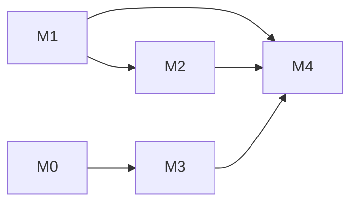

# Dependencies

Generated by `npm run plan:report`. The task DAG in TASKS.json is authoritative; milestone aggregation can hide independent streams. Optional dependencies are advisory.

- M0-01 ← none
- M0-02 ← none
- M0-03 ← none
- M0-04 ← none
- M0-05 ← none
- M0-06 ← none
- M0-07 ← none
- M0-08 ← none
- M0-09 ← none
- M0-10 ← none
- M0-11 ← none
- M0-12 ← none
- M0-13 ← none
- M0-14 ← none
- M0-15 ← none
- M0-16 ← none
- M0-17 ← none
- M0-18 ← none
- M0-19 ← none
- M0-20 ← none
- M0-21 ← none
- M0-22 ← none
- M0-14-R1 ← M0-14 (hard)
- M0-15-R1 ← M0-15 (hard)
- M0-15-R2 ← M0-15-R1 (hard)
- M0-19-R1 ← M0-19 (hard)
- M0-22-R1 ← M0-22 (hard)
- M0-23 ← none
- M0-30 ← none
- M1-01 ← none
- M1-02 ← M1-01 (fixture)
- M1-03 ← M1-01 (fixture)
- M1-04 ← M1-01 (fixture), M1-03 (hard)
- M1-05 ← M1-01 (fixture)
- M1-06 ← M1-01 (fixture)
- M1-07 ← M1-01 (fixture), M1-03 (hard), M1-04 (hard)
- M1-08 ← M1-01 (fixture)
- M1-09 ← M1-01 (fixture), M1-02 (hard)
- M1-98 ← M1-02 (hard), M1-03 (hard), M1-04 (hard), M1-05 (hard), M1-06 (hard), M1-07 (hard), M1-08 (hard), M1-09 (hard)
- M1-99 ← none; gate G-RELEASE
- M2-01 ← none
- M2-02 ← M1-01 (fixture)
- M2-03 ← M2-02 (fixture)
- M2-04 ← M2-03 (hard)
- M2-05 ← M2-03 (hard)
- M2-03-R1 ← M2-03 (hard)
- M2-04-R1 ← M2-04 (hard), M2-05 (hard)
- M2-06 ← M2-04 (hard), M2-05 (hard), M1-98 (quality), M2-01 (hard), M2-03-R1 (hard), M2-04-R1 (hard)
- M2-07 ← M2-06 (hard)
- M3-01 ← M0-06-R1 (quality), M0-05-R1 (quality), M0-04-R1 (quality), M0-12-R1 (quality), M0-12-R2 (quality), M0-17-R1 (quality), M0-07-R1 (quality), M0-09-R1 (quality), M0-08-R1 (quality), M0-11-R1 (quality), M0-20-R1 (quality), M0-02-R1 (quality), M0-01-R1 (quality), M0-18-R1 (quality), M0-03-R2 (quality), M0-05-R2 (quality), M0-09-R2 (quality), M0-10-R1 (quality)
- M3-02 ← M3-01 (fixture)
- M3-03 ← M3-01 (fixture)
- M3-04 ← M3-01 (fixture)
- M3-05 ← M3-03 (hard)
- M3-06 ← M3-02 (hard)
- M4-01 ← M1-01 (hard), M2-02 (hard), M3-01 (hard)
- M4-02 ← none
- M0-31 ← none
- M0-32 ← none
- M0-33 ← none
- M0-34 ← none
- M0-35 ← none
- M0-36 ← none
- M0-37 ← none
- M0-38 ← none
- M0-39 ← none
- M4-03 ← none
- M4-04 ← none
- M4-05 ← none
- M4-06 ← none
- M4-07 ← none
- M0-22-R2 ← M0-22-R1 (hard)
- M0-40 ← none
- M0-41 ← none
- M0-06-R1 ← M0-06 (hard)
- M0-05-R1 ← M0-05 (hard)
- M0-04-R1 ← M0-04 (hard)
- M0-12-R1 ← M0-12 (hard), M0-17 (hard)
- M0-12-R2 ← M0-12 (hard)
- M0-17-R1 ← M0-17 (hard), M0-12 (hard)
- M0-07-R1 ← M0-07 (hard), M0-09 (hard)
- M0-09-R1 ← M0-09 (hard)
- M0-08-R1 ← M0-08 (hard)
- M0-11-R1 ← M0-11 (hard), M0-21 (hard), M0-18 (hard)
- M0-20-R1 ← M0-20 (hard)
- M0-02-R1 ← M0-02 (hard), M0-04 (hard)
- M0-01-R1 ← M0-01 (hard)
- M0-18-R1 ← M0-18 (hard)
- M0-03-R1 ← M0-03 (hard), M0-05 (hard), M0-09 (hard), M0-10 (hard)
- M0-03-R2 ← M0-03 (hard), M0-05-R1 (hard)
- M0-05-R2 ← M0-05-R1 (hard)
- M0-09-R2 ← M0-09-R1 (hard), M0-07-R1 (hard)
- M0-10-R1 ← M0-10 (hard)
- M0-05-R3 ← M0-05-R2 (hard)
