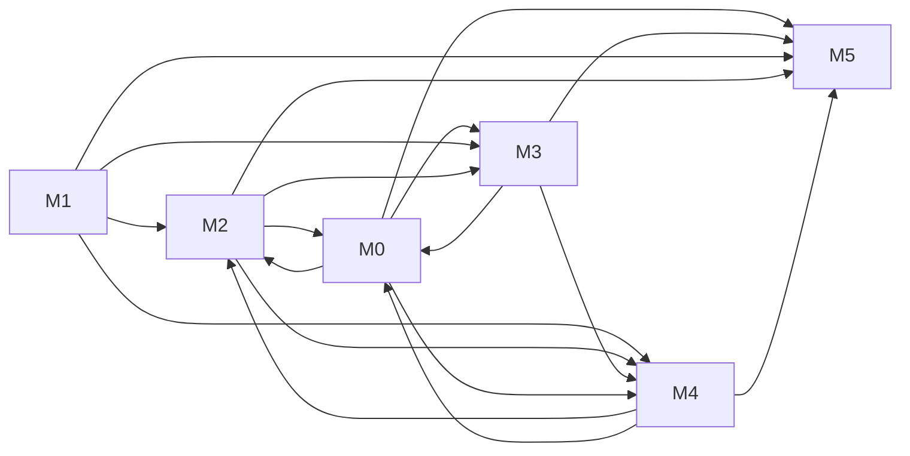

# Dependencies

Generated by `npm run plan:report`. The task DAG in TASKS.json is authoritative; milestone aggregation can hide independent streams. Optional dependencies are advisory.

- M0-01 ← none
- M0-02 ← none
- M0-03 ← none
- M0-04 ← none
- M0-05 ← none
- M0-06 ← none
- M0-07 ← none
- M0-08 ← none
- M0-09 ← none
- M0-10 ← none
- M0-11 ← none
- M0-12 ← none
- M0-13 ← none
- M0-14 ← none
- M0-15 ← none
- M0-16 ← none
- M0-17 ← none
- M0-18 ← none
- M0-19 ← none
- M0-20 ← none
- M0-21 ← none
- M0-22 ← none
- M0-14-R1 ← M0-14 (hard)
- M0-15-R1 ← M0-15 (hard)
- M0-15-R2 ← M0-15-R1 (hard)
- M0-19-R1 ← M0-19 (hard)
- M0-22-R1 ← M0-22 (hard)
- M0-23 ← none
- M0-30 ← none
- M1-01 ← none
- M1-02 ← M1-01 (fixture)
- M1-03 ← M1-01 (fixture)
- M1-04 ← M1-01 (fixture), M1-03 (hard)
- M1-05 ← M1-01 (fixture)
- M1-06 ← M1-01 (fixture)
- M1-07 ← M1-01 (fixture), M1-03 (hard), M1-04 (hard)
- M1-08 ← M1-01 (fixture)
- M1-09 ← M1-01 (fixture), M1-02 (hard)
- M1-98 ← M1-02 (hard), M1-03 (hard), M1-04 (hard), M1-05 (hard), M1-06 (hard), M1-07 (hard), M1-08 (hard), M1-09 (hard)
- M1-99 ← none; gate G-RELEASE
- M2-01 ← none
- M2-02 ← M1-01 (fixture)
- M2-03 ← M2-02 (fixture)
- M2-04 ← M2-03 (hard)
- M2-05 ← M2-03 (hard)
- M2-03-R1 ← M2-03 (hard)
- M2-04-R1 ← M2-04 (hard), M2-05 (hard)
- M2-06 ← M2-04 (hard), M2-05 (hard), M1-98 (quality), M2-01 (hard), M2-03-R1 (hard), M2-04-R1 (hard)
- M2-07 ← M2-06 (hard)
- M0-02-R3 ← M0-02-R2 (hard)
- M0-02-R4 ← M0-02-R3 (hard), M0-10-R3 (hard)
- M0-02-R5 ← M0-02-R4 (hard)
- M0-02-R6 ← M0-02-R5 (hard)
- M0-10-R3 ← M0-10-R2 (hard)
- M0-03-R4 ← M0-03-R3 (hard), M0-05-R4 (hard)
- M0-17-R3 ← M0-17-R2 (hard)
- M0-17-R4 ← M3-10 (hard), M0-17-R3 (hard)
- M1-05-R2 ← M1-05-R1 (hard)
- M1-05-R3 ← M1-05-R2 (hard)
- M0-32-R2 ← M0-32-R1 (hard), M2-06-R1 (hard), M0-07-R2 (hard), M0-09-R3 (hard)
- M3-01 ← M0-06-R1 (quality), M0-05-R1 (quality), M0-04-R1 (quality), M0-12-R1 (quality), M0-12-R2 (quality), M0-17-R1 (quality), M0-07-R1 (quality), M0-09-R1 (quality), M0-08-R1 (quality), M0-11-R1 (quality), M0-20-R1 (quality), M0-02-R1 (quality), M0-01-R1 (quality), M0-18-R1 (quality), M0-03-R2 (quality), M0-05-R2 (quality), M0-09-R2 (quality), M0-10-R1 (quality), M0-05-R3 (quality), M0-20-R2 (quality), M0-11-R2 (quality), M0-02-R2 (quality), M0-04-R2 (quality), M0-09-R3 (quality), M0-10-R2 (quality), M0-12-R3 (quality), M0-12-R4 (quality), M0-17-R2 (quality), M0-03-R3 (quality), M0-05-R4 (quality), M0-07-R2 (quality), M1-03-R1 (quality), M1-07-R1 (quality), M1-05-R1 (quality), M2-04-R2 (quality), M2-06-R1 (quality), M0-32-R1 (quality), M0-02-R3 (quality), M0-10-R3 (quality), M0-03-R4 (quality), M0-17-R3 (quality), M1-05-R2 (quality), M0-32-R2 (quality), M0-02-R4 (quality), M0-02-R5 (quality), M0-04-R3 (quality), M0-09-R4 (quality), M0-12-R5 (quality), M1-05-R3 (quality), M0-12-R6 (quality)
- M3-02 ← M3-01 (fixture)
- M3-03 ← M3-01 (fixture)
- M3-04 ← M3-01 (fixture)
- M3-05 ← M3-03 (hard)
- M3-06 ← M3-02 (hard)
- M3-07 ← M3-01 (fixture)
- M3-08 ← M3-02 (hard), M3-07 (hard), M3-06 (hard)
- M3-09 ← M3-04 (hard)
- M3-10 ← M3-06 (hard)
- M3-11 ← M3-06 (hard)
- M3-12 ← M3-09 (hard), M3-06 (hard)
- M4-01 ← M1-01 (hard), M2-02 (hard), M3-01 (hard), M0-02-R6 (hard), M0-17-R4 (hard), M3-08-R1 (hard), M3-09-R1 (hard), M0-02-R7 (hard), M0-10-R4 (hard), M1-07-R2 (hard), M0-04-R6 (hard), M3-02-R1 (hard), M3-05-R1 (hard), M3-11-R1 (hard), M3-07-R1 (hard), M0-12-R7 (hard), M0-17-R5 (hard), M0-20-R3 (hard), M2-06-R2 (hard), M2-04-R3 (hard), M0-09-R5 (hard), M1-03-R2 (hard), M0-11-R3 (hard), M0-02-R8 (hard), M0-12-R8 (hard), M0-12-R9 (hard)
- M4-02 ← none
- M0-31 ← none
- M0-32 ← none
- M0-32-R1 ← M0-32 (hard)
- M0-33 ← none
- M0-34 ← none
- M0-35 ← none
- M0-36 ← none
- M0-37 ← none
- M0-38 ← none
- M0-39 ← none
- M4-03 ← M0-02-R6 (hard), M0-17-R4 (hard), M3-08-R1 (hard), M3-09-R1 (hard), M0-02-R7 (hard), M0-10-R4 (hard), M1-07-R2 (hard), M0-04-R6 (hard), M3-02-R1 (hard), M3-05-R1 (hard), M3-11-R1 (hard), M3-07-R1 (hard), M0-12-R7 (hard), M0-17-R5 (hard), M0-20-R3 (hard), M2-06-R2 (hard), M2-04-R3 (hard), M0-09-R5 (hard), M1-03-R2 (hard), M0-11-R3 (hard), M0-02-R8 (hard), M0-12-R8 (hard), M0-12-R9 (hard)
- M4-04 ← M0-02-R6 (hard), M0-17-R4 (hard), M3-08-R1 (hard), M3-09-R1 (hard), M0-02-R7 (hard), M0-10-R4 (hard), M1-07-R2 (hard), M0-04-R6 (hard), M3-02-R1 (hard), M3-05-R1 (hard), M3-11-R1 (hard), M3-07-R1 (hard), M0-12-R7 (hard), M0-17-R5 (hard), M0-20-R3 (hard), M2-06-R2 (hard), M2-04-R3 (hard), M0-09-R5 (hard), M1-03-R2 (hard), M0-11-R3 (hard), M0-02-R8 (hard), M0-12-R8 (hard), M0-12-R9 (hard)
- M4-05 ← M0-02-R6 (hard), M0-17-R4 (hard), M3-08-R1 (hard), M3-09-R1 (hard), M0-02-R7 (hard), M0-10-R4 (hard), M1-07-R2 (hard), M0-04-R6 (hard), M3-02-R1 (hard), M3-05-R1 (hard), M3-11-R1 (hard), M3-07-R1 (hard), M0-12-R7 (hard), M0-17-R5 (hard), M0-20-R3 (hard), M2-06-R2 (hard), M2-04-R3 (hard), M0-09-R5 (hard), M1-03-R2 (hard), M0-11-R3 (hard), M0-02-R8 (hard), M0-12-R8 (hard), M0-12-R9 (hard)
- M4-06 ← none
- M4-07 ← none
- M0-22-R2 ← M0-22-R1 (hard)
- M0-40 ← none
- M0-41 ← none
- M0-06-R1 ← M0-06 (hard)
- M0-05-R1 ← M0-05 (hard)
- M0-04-R1 ← M0-04 (hard)
- M0-12-R1 ← M0-12 (hard), M0-17 (hard)
- M0-12-R2 ← M0-12 (hard)
- M0-17-R1 ← M0-17 (hard), M0-12 (hard)
- M0-07-R1 ← M0-07 (hard), M0-09 (hard)
- M0-09-R1 ← M0-09 (hard)
- M0-08-R1 ← M0-08 (hard)
- M0-11-R1 ← M0-11 (hard), M0-21 (hard), M0-18 (hard)
- M0-20-R1 ← M0-20 (hard)
- M0-02-R1 ← M0-02 (hard), M0-04 (hard)
- M0-01-R1 ← M0-01 (hard)
- M0-18-R1 ← M0-18 (hard)
- M0-03-R1 ← M0-03 (hard), M0-05 (hard), M0-09 (hard), M0-10 (hard)
- M0-03-R2 ← M0-03 (hard), M0-05-R1 (hard)
- M0-05-R2 ← M0-05-R1 (hard)
- M0-09-R2 ← M0-09-R1 (hard), M0-07-R1 (hard)
- M0-10-R1 ← M0-10 (hard)
- M0-05-R3 ← M0-05-R2 (hard)
- M0-20-R2 ← M0-20-R1 (hard)
- M0-11-R2 ← M0-11-R1 (hard)
- M0-02-R2 ← M0-02-R1 (hard)
- M0-04-R2 ← M0-04-R1 (hard)
- M0-04-R3 ← M0-04-R2 (hard)
- M0-04-R5 ← M0-04-R3 (hard)
- M0-09-R4 ← M0-09-R3 (hard)
- M0-12-R5 ← M0-12-R4 (hard)
- M0-12-R6 ← M0-12-R5 (hard), M0-09-R4 (hard)
- M0-09-R3 ← M0-09-R2 (hard)
- M0-10-R2 ← M0-10-R1 (hard)
- M0-12-R3 ← M0-12-R1 (hard), M0-12-R2 (hard)
- M0-12-R4 ← M0-12-R3 (hard)
- M0-17-R2 ← M0-17-R1 (hard), M0-01-R1 (hard)
- M0-03-R3 ← M0-03-R2 (hard)
- M0-05-R4 ← M0-05-R2 (hard)
- M0-07-R2 ← M0-07-R1 (hard)
- M1-03-R1 ← M1-03 (hard), M1-06 (hard)
- M1-07-R1 ← M1-07 (hard), M1-04 (hard)
- M1-05-R1 ← M1-05 (hard)
- M2-04-R2 ← M2-04-R1 (hard), M2-05 (hard)
- M2-06-R1 ← M2-06 (hard), M2-07 (hard)
- M5-01 ← M0-02-R6 (hard), M0-17-R4 (hard), M3-08-R1 (hard), M3-09-R1 (hard), M0-02-R7 (hard), M0-10-R4 (hard), M1-07-R2 (hard), M0-04-R6 (hard), M3-02-R1 (hard), M3-05-R1 (hard), M3-11-R1 (hard), M3-07-R1 (hard), M0-12-R7 (hard), M0-17-R5 (hard), M0-20-R3 (hard), M2-06-R2 (hard), M2-04-R3 (hard), M0-09-R5 (hard), M1-03-R2 (hard), M0-11-R3 (hard), M0-02-R8 (hard), M0-12-R8 (hard), M0-12-R9 (hard), M2-08 (hard), M0-02-R9 (hard), M0-12-R10 (hard), M0-17-R6 (hard), M0-02-R10 (hard), M4-10 (hard), M4-11 (hard), M4-13 (hard), M4-12 (hard), M4-14 (hard), M4-15 (hard), M4-16 (hard), M4-19 (hard), M4-17 (hard), M4-20 (hard), M4-21 (hard), M4-22 (hard), M4-23 (hard)
- M5-02 ← M0-02-R6 (hard), M0-17-R4 (hard), M3-08-R1 (hard), M3-09-R1 (hard), M0-02-R7 (hard), M0-10-R4 (hard), M1-07-R2 (hard), M0-04-R6 (hard), M3-02-R1 (hard), M3-05-R1 (hard), M3-11-R1 (hard), M3-07-R1 (hard), M0-12-R7 (hard), M0-17-R5 (hard), M0-20-R3 (hard), M2-06-R2 (hard), M2-04-R3 (hard), M0-09-R5 (hard), M1-03-R2 (hard), M0-11-R3 (hard), M0-02-R8 (hard), M0-12-R8 (hard), M0-12-R9 (hard), M2-08 (hard), M0-02-R9 (hard), M0-12-R10 (hard), M0-17-R6 (hard), M0-02-R10 (hard), M4-10 (hard), M4-11 (hard), M4-13 (hard), M4-12 (hard), M4-14 (hard), M4-15 (hard), M4-16 (hard), M4-19 (hard), M4-17 (hard), M4-20 (hard), M4-21 (hard), M4-22 (hard), M4-23 (hard)
- M5-03 ← M5-01 (fixture), M5-02 (hard)
- M5-04 ← M5-03 (hard)
- M5-05 ← M5-04 (hard)
- M5-06 ← M5-05 (hard)
- M5-07 ← M5-05 (hard)
- M5-08 ← M5-04 (hard), M5-05 (interface)
- M5-09 ← M5-03 (hard)
- M5-10 ← M5-01 (fixture), M3-04 (interface)
- M5-11 ← M5-04 (hard), M5-10 (hard)
- M5-12 ← M5-01 (fixture), M5-03 (hard), M4-03 (interface)
- M5-13 ← M5-04 (hard)
- M5-14 ← M5-05 (hard), M5-08 (hard)
- M5-15 ← M5-05 (hard), M5-13 (hard)
- M5-16 ← M5-04 (hard), M5-08 (hard)
- M5-17 ← M5-04 (hard), M5-06 (hard)
- M5-18 ← M5-05 (hard), M5-06 (hard), M5-07 (hard), M4-01 (interface)
- M5-98 ← M5-04 (quality), M5-06 (quality), M5-11 (quality), M5-16 (quality)
- M4-08 ← M3-01 (hard), M0-02-R6 (hard), M0-17-R4 (hard), M3-08-R1 (hard), M3-09-R1 (hard), M0-02-R7 (hard), M0-10-R4 (hard), M1-07-R2 (hard), M0-04-R6 (hard), M3-02-R1 (hard), M3-05-R1 (hard), M3-11-R1 (hard), M3-07-R1 (hard), M0-12-R7 (hard), M0-17-R5 (hard), M0-20-R3 (hard), M2-06-R2 (hard), M2-04-R3 (hard), M0-09-R5 (hard), M1-03-R2 (hard), M0-11-R3 (hard), M0-02-R8 (hard), M0-12-R8 (hard), M0-12-R9 (hard)
- M3-08-R1 ← M3-08 (hard), M3-11 (hard)
- M3-09-R1 ← M3-09 (hard), M3-12 (hard)
- M0-02-R7 ← M0-02-R4 (hard), M0-02-R5 (hard)
- M0-10-R4 ← M0-10-R3 (hard), M0-02-R2 (hard)
- M1-07-R2 ← M1-07-R1 (hard), M1-03-R1 (hard), M1-05-R1 (hard)
- M0-04-R6 ← M0-04-R3 (hard)
- M3-02-R1 ← M3-02 (hard), M3-03 (hard)
- M3-05-R1 ← M3-05 (hard), M3-04 (hard)
- M3-11-R1 ← M3-11 (hard), M3-08-R1 (hard)
- M3-07-R1 ← M3-07 (hard)
- M0-12-R7 ← M0-12-R4 (hard)
- M0-17-R5 ← M0-17-R2 (hard), M0-17-R3 (hard)
- M0-20-R3 ← M0-20-R2 (hard)
- M2-06-R2 ← M2-06-R1 (hard)
- M2-04-R3 ← M2-04-R2 (hard)
- M0-09-R5 ← M0-09-R4 (hard)
- M1-03-R2 ← M1-03-R1 (hard), M1-07-R2 (hard)
- M0-11-R3 ← M0-11-R2 (hard), M0-03-R4 (hard)
- M0-12-R8 ← M0-11-R3 (hard)
- M4-09 ← none
- M0-12-R9 ← M0-12-R7 (hard)
- M0-02-R8 ← M0-02-R7 (hard), M0-17-R4 (hard)
- M2-08 ← M4-01 (hard), M4-03 (hard), M4-04 (hard), M4-05 (hard), M4-08 (hard), M0-17-R4 (hard), M0-02-R7 (hard)
- M0-02-R9 ← M4-01 (hard), M4-03 (hard), M4-04 (hard), M4-05 (hard), M4-08 (hard), M0-02-R8 (hard)
- M0-12-R10 ← M4-01 (hard), M4-03 (hard), M4-04 (hard), M4-05 (hard), M4-08 (hard), M0-12-R8 (hard)
- M0-17-R6 ← M4-01 (hard), M4-03 (hard), M4-04 (hard), M4-05 (hard), M4-08 (hard), M0-02-R8 (hard), M3-11-R1 (hard), M3-09-R1 (hard), M0-17-R5 (hard)
- M5-19 ← M5-03 (hard), M5-01 (fixture), M4-03 (interface)
- M5-20 ← M5-19 (hard), M5-01 (fixture)
- M5-21 ← M5-19 (hard), M5-01 (fixture)
- M5-22 ← M5-19 (hard), M5-01 (fixture)
- M5-23 ← M5-19 (hard), M5-01 (fixture)
- M5-24 ← M5-20 (hard), M5-21 (hard), M5-22 (hard), M5-23 (hard), M5-04 (hard)
- M0-02-R10 ← M4-04 (hard)
- M0-07-R3 ← M0-07-R2 (hard)
- M0-10-R5 ← M0-10-R4 (hard)
- M0-06-R2 ← M0-06-R1 (hard)
- M4-10 ← M0-06-R2 (hard)
- M4-11 ← M4-10 (hard)
- M4-13 ← M4-11 (hard)
- M4-12 ← M4-13 (hard)
- M4-14 ← M4-12 (hard)
- M4-15 ← M4-14 (hard)
- M4-16 ← M4-15 (hard)
- M4-19 ← M4-16 (hard)
- M4-17 ← M4-16 (hard), M4-19 (hard), M0-32-R3 (hard)
- M4-18 ← M4-16 (hard)
- M4-24 ← M4-17 (hard)
- M4-20 ← M4-16 (hard), M4-19 (hard), M4-24 (hard)
- M4-21 ← M4-17 (hard)
- M4-22 ← M4-21 (hard)
- M4-23 ← M4-21 (hard)
- M0-32-R3 ← M0-32-R2 (hard)
