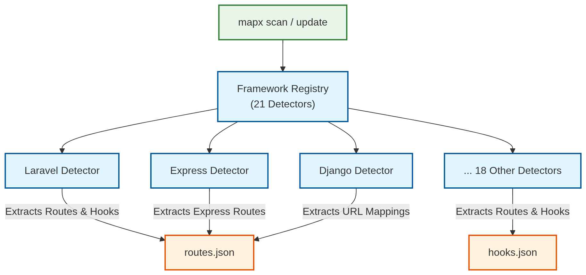
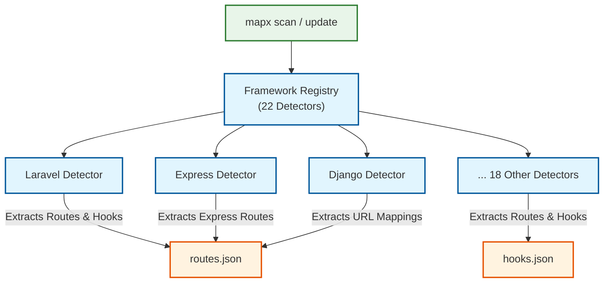

# Framework & Routing Integration

MapxGraph features built-in framework detection and automatic route/hook extraction for **22 popular frameworks** across multiple languages. This allows developers and LLMs to map external HTTP requests, event triggers, and mobile navigation routes directly to their implementing files and handler symbols.

## How It Works

During a codebase scan (via `mapx scan` or `mapx update`), MapxGraph executes framework-specific detectors to:
1. **Detect Active Frameworks**: Checks project configuration files (e.g., `package.json`, `composer.json`, `requirements.txt`, `Gemfile`) and matches file extension patterns or directory structures. This detector scan is **monorepo-aware**: a `package.json` or `composer.json` in a sub-folder (such as `frontend/package.json` or `apps/api/package.json`) activates the matching detector (Vue Router, NestJS, Next.js, React Router, TanStack Router, SvelteKit, Symfony, Yii) for the files under that folder only, so a Vue sub-app's route extraction never reaches a backend beside it. Vue global components and Vue Router route tables go further: each built app (a folder with a bundler config, or a `package.json` listing a build tool) keeps its own, whatever the root manifest lists, so one app never renders another app's global component or navigates to its routes, and a folder where vue-router is not active is never a navigation target. A component library (vue as a peer dependency, a Vite `build.lib` or Vue CLI `--target lib` build, or `exports`/`module`) shares its registrations, such as a plugin's `install(app)`, with every app; a component that another app's registering file imports (a Laravel module registered by the root `app.js`) also sees that app's registrations. A `{"type": "module"}` marker is no boundary. A manifest at the repo root activates its detector for the whole repo. Laravel finds applications up to three folders down by their `artisan` or `composer.json`.
2. **Extract API Routes**: Parses routing configurations to map HTTP verbs (GET, POST, PUT, DELETE, etc.) and URL path patterns to their handler files and controller symbols.
3. **Extract Hooks & Events**: Maps event listener bindings (e.g., WordPress actions/filters, Laravel event listeners) to their respective handler functions.
4. **Persist Registry**: Saves findings to `.mapx/routes.json` and `.mapx/hooks.json` to keep them queryable.

<!--  -->



---

## Supported Frameworks (22 total)

| Framework | Language | Heuristic & Scope |
|-----------|----------|-------------------|
| **Laravel** | PHP | Composer dependencies (`laravel/framework`), routes files, controller method mappings, event listeners, and hooks. Migrations, seeders, factories and Blade views give their class edges when indexed (they are excluded by default: see [Laravel default excludes](configuration.md#laravel-default-excludes)). |
| **Express** | JavaScript / TypeScript | Package dependency (`express`), `app.use()` route prefixes, inline controllers, and modular router mappings. |
| **Django** | Python | Heuristic checks for `manage.py`, `wsgi.py`, pattern matching on `urlpatterns`, class-based and function views. |
| **Flask** | Python | Heuristic checks on imports, `@app.route()`, and Blueprint registrations. |
| **FastAPI** | Python | Heuristic checks on imports, `@app.get()`, `@app.post()`, and APIRouter mountings. |
| **NestJS** | TypeScript | Package dependency (`@nestjs/core`), `@Controller()` classes, and `@Get()/@Post()` method decorators. |
| **React Router** | JS / TS | Checks routes definition arrays, `<Route path="..." element={...}>` declarations. |
| **TanStack Router** | JS / TS | Package dependency (`@tanstack/react-router`), parses route files and directory-based routes. |
| **Next.js** | JS / TS | Page routing layouts (`pages/` directory or `app/` directory routes matching `/route.ts`, `page.tsx`). |
| **SvelteKit** | Svelte / JS / TS | Directory structure (`src/routes/`), parses page endpoint routing scripts (`+page.svelte`, `+server.ts`). |
| **Vue Router** | JS / TS | Package dependency (`vue-router`), routes arrays, lazy-loaded route bundle declarations. A route's component resolves through the router file's import of it, with the app's own aliases (see [Import aliases](#import-aliases-js--ts)). Navigation (`router.push`, `this.$router.push`, `<router-link :to>`, a `push` destructured from `useRouter()`, `this.router` in a Pinia store, and guard redirects through `next(target)` or a returned location, in components and in plain JS/TS stores, guards and composables) gives `navigate` edges to the component of the route record it names exactly; route modules exported as `export default [ … ]` and spread into the routes belong to the route table; they are not routes and do not appear in `mapx routes`. |
| **Drupal** | PHP | Checks for `.info.yml` files, custom routes yml, hooks, and theme hook registrations. |
| **Rails** | Ruby | Checks for `Gemfile` containing `rails`, parses `config/routes.rb` files. |
| **Spring** | Java | Checks for `@RestController`, `@RequestMapping`, `@GetMapping`, and `@PostMapping` annotations. |
| **Go (Gin/Fiber)** | Go | Scans imports for `github.com/gin-gonic/gin` or `github.com/gofiber/fiber`, extracts router configurations. |
| **Rust (Actix/Axum)**| Rust | Scans imports for `actix-web` or `axum`, parses handler macros and routing setups. |
| **ASP.NET** | C# | Scans for `Microsoft.AspNetCore`, `[Route]` attributes, and minimal API route builders. |
| **Vapor** | Swift | Scans `Package.swift` and routes code declarations mapping methods to controllers. |
| **Symfony** | PHP | Composer dependencies (`symfony/framework-bundle`), annotations/attributes, YAML routes. |
| **Yii** | PHP | Heuristics on controller actions (`actionIndex`) and URL rules. |
| **WordPress** | PHP | Detects theme and plugin structures, extracts `add_action()` and `add_filter()` hooks. |
| **Flutter** | Dart | Detects Flutter projects via `pubspec.yaml` (`sdk: flutter`) or `lib/main.dart`; extracts `Navigator.pushNamed`, `MaterialApp` routes, `GoRouter` (`GoRoute(path: '...')`), and `auto_route` (`@RoutePage()`) routes; extracts widget lifecycle hooks (`initState`, `dispose`, `build`, `didChangeDependencies`) and state-management bindings for Provider/Riverpod, BLoC, and GetX. |

### Import aliases (JS / TS)

JS, TS, Vue and Svelte imports such as `@/views/Home.vue`, `~/store` or `#utils` resolve through the configuration of the app that holds the importing file. The same lookup serves import, render, mixin and composable edges, Vue Router route components and `navigate` edges, and the HTTP pass's client imports. Configs are read statically and never executed.

- **Package root.** The nearest folder, from the importing file upwards, that holds a bundler config or a `package.json` naming a package or dependencies. A marker such as `{"type": "module"}` is no boundary. Bundler aliases never cross a package root: a Vue CLI app in `frontend/` with its own `package.json` keeps `@/` → `frontend/src/`, even when the Laravel root's `vite.config.js` maps `'@'` to `resources/js`.
- **`compilerOptions.paths`** come from the nearest `tsconfig.json` / `jsconfig.json` above the file, as `tsc` finds it, so a monorepo package without its own tsconfig uses the root's `paths`. They do not come from above a separately built app (a bundler config, or a bundler or dev server such as `vite`, `webpack` or `@vue/cli-service` among its dependencies). Its relative `extends` chain is followed (`baseUrl` is inherited). When it has no `paths`, the configs it lists in `references` are read. The nearest config decides, even when it declares no `paths`. A tsconfig alone (such as `tests/tsconfig.json`) does not make a package root, so the app's bundler aliases still apply below it.
- **Bundler aliases** come from the package root's `vite.config.*`, `vue.config.*`, `webpack.config.*` and `webpack.mix.js`. The forms read are `alias: { … }`, `alias: [{ find, replacement }]`, `mix.alias({ … })` and `config.resolve.alias.set(…)`, including chained `.set(…).set(…)`. A value must be a string (a leading `/` is relative to the package root), `path.resolve` / `path.join(__dirname, '…')` (Windows `\\` separators are accepted) or `fileURLToPath(new URL('…', import.meta.url))`.
- **Order.** `paths` come before bundler aliases. An exact pattern wins, then the longest prefix. A bundler key `k` covers `k` and `k/…`; `k$` covers `k` only.
- **Fallback.** With no matching alias, `@/x` is `src/x` under the package root, then under the `src/` folder that encloses the importing file, then under the workspace root. `~/x` has no fallback.
- **Module roots** (bare imports such as `models/user` or `require('lib/a')`, M2-08-R11). A bare specifier is a package, never a path from the repo root, unless the project says otherwise in a config that is read statically: webpack `resolve.modules` (`webpack.config.*`, `vue.config.*`, `webpack.mix.js`, `craco.config.*`, `next.config.*`: `modules: [path.resolve(__dirname, 'src'), 'node_modules']`, `[__dirname]`, a relative name such as `'src'`, `config.resolve.modules.push(…)`), jest `moduleDirectories` and `modulePaths` (the package.json `jest` key, `jest.config.*`; `<rootDir>` is substituted; jest `roots` only locate tests and are not read) and `NODE_PATH=src:lib` in a package.json script. Each root applies to the files under the folder that declares it; the nearest webpack config and the nearest jest config decide, even when they list no root, and only their top-level keys are read (a list element MapX cannot read, such as `...defaults.moduleDirectories`, counts as `node_modules`). A root listed before `node_modules` wins over a workspace package, one searched after it (`NODE_PATH`, jest) loses to a workspace package, to a package the nearest package.json lists and to a Node built-in; `paths`, aliases and `baseUrl` come first. A specifier a root resolves is a project module, not an npm external. Not read: Deno `deno.json` import maps, `.env` `NODE_PATH`, jest `moduleNameMapper` and `projects`.
- **SvelteKit `$lib`** resolves through `paths` in the generated `.svelte-kit/tsconfig.json` that the app's tsconfig extends, while that file is on disk (run `svelte-kit sync` or a build first in a fresh clone).
- **Not read:** `extends` from npm packages, `package.json` `imports`, Nuxt / SvelteKit (`kit.alias`) / Quasar alias configs, aliases computed at runtime, RegExp `find` keys, and tsconfig `include` / `files`.

---

## CLI Usage

Use the CLI to inspect and query routes and event hooks:

### 1. Listing and Querying Routes

```bash
# Show all detected routes in the codebase
mapx routes

# Filter routes by framework
mapx routes --framework express

# Filter routes by HTTP method
mapx routes --method POST

# Filter routes by URL path pattern
mapx routes --path-pattern "/api/v1/users"

# Output as raw JSON for external integration
mapx routes --json
```

**CLI Output Example:**
```
Detected Routes (3):
--------------------------------------------------------------------------------
Framework    | Method   | Path                           | Handler
--------------------------------------------------------------------------------
express      | GET      | /api/users                     | src/controllers/UserController.ts#listUsers
express      | POST     | /api/users                     | src/controllers/UserController.ts#createUser
express      | DELETE   | /api/users/:id                 | src/controllers/UserController.ts#deleteUser
--------------------------------------------------------------------------------
```

### 2. Listing and Querying Hooks

```bash
# Show all registered hooks, actions, filters, or event listeners
mapx hooks

# Filter hooks by framework
mapx hooks --framework wordpress

# Filter hooks by event type (e.g. action, filter, event)
mapx hooks --type action

# Filter hooks by hook name pattern
mapx hooks --name "user_register"

# Output hooks as JSON
mapx hooks --json
```

**CLI Output Example:**
```
Detected Hooks (2):
--------------------------------------------------------------------------------
Framework    | Type            | Hook Name                 | Handler
--------------------------------------------------------------------------------
wordpress    | action          | user_register             | inc/notify.php#send_welcome_email
wordpress    | filter          | the_content               | inc/filters.php#add_social_links
--------------------------------------------------------------------------------
```

---

## HTTP pairing

MapX links a frontend's HTTP calls to the backend routes they reach, also when the frontend and the backend are separate registered repositories:

1. **Call sites.** In JS, TS and Vue files it finds calls through axios, `fetch`, `axios.create` instances, client factories such as `Api()`, aliases of these, and the receivers you configure in `settings.http.clients`.
2. **URLs.** It resolves each URL statically: string constants, template literals, conditional branches, the client's `baseURL` (from `axios.create` options or `.env*` files, with Vite's `${A:-default}` expansion), joined as axios joins them.
3. **Pairing.** Each call pairs with the live route it reaches, by method and path: at least one literal path segment must match, and an absolute URL must name one of the workspace's own hosts (`settings.http.hosts`, `.env*` URLs, client base URLs, literal Laravel `Route::domain()` hosts). A paired call becomes an `http` edge from the calling file to the route handler, and a cross-repo edge when the two are in different repos.

`mapx routes --clients` (MCP: `mapx_routes { clients: "all" }`) lists every call with its resolved URL and route; `--unmatched` lists the calls that reach no route. The dashboard's HTTP Calls tab draws the calls between repos. The exact rules are in [`mapx routes`](cli-reference.md#mapx-routes), and the configuration in [Settings](configuration.md#settings).

---

## MCP Tools Integration

When integrating MapxGraph with LLM agents (e.g., Claude Desktop, Cursor), two specialized tools are exposed:

### `mapx_routes`
Query routes from all detected frameworks.
* **Arguments**:
  * `framework` (string, optional) — Filter routes by framework name (e.g., `laravel`, `express`).
  * `method` (string, optional) — Filter routes by HTTP method (e.g., `GET`, `POST`).
  * `pathPattern` (string, optional) — Filter routes by route path pattern.
  * `clients` (`"all"` | `"unmatched"`, optional) — List frontend HTTP calls instead (see [HTTP pairing](#http-pairing)).
  * `dir` (string, optional) — Target project directory.

### `mapx_hooks`
Query hooks/events from all detected frameworks.
* **Arguments**:
  * `framework` (string, optional) — Filter hooks by framework name.
  * `type` (string, optional) — Filter by hook type (e.g., `action`, `filter`, `listener`).
  * `namePattern` (string, optional) — Filter by hook name pattern.
  * `dir` (string, optional) — Target project directory.

---

## Developer Workflows

Here are common use cases for developer agents using framework-specific routes:

1. **Bug Resolution**: When a client reports that `POST /api/v1/checkout` fails, the agent can call `mapx_routes` to find that this route is handled by `CheckoutController::processCheckout` in `src/controllers/CheckoutController.php`, then inspect that code immediately.
2. **Impact Assessment**: Before modifying a controller method, an agent can check if it is hooked to any framework events or is exposed via specific API endpoints, helping preserve backward compatibility.
3. **Refactoring / Cleanup**: Finding dead controller endpoints or orphaned event listeners that are defined in routes but have no actual active code dependencies.
