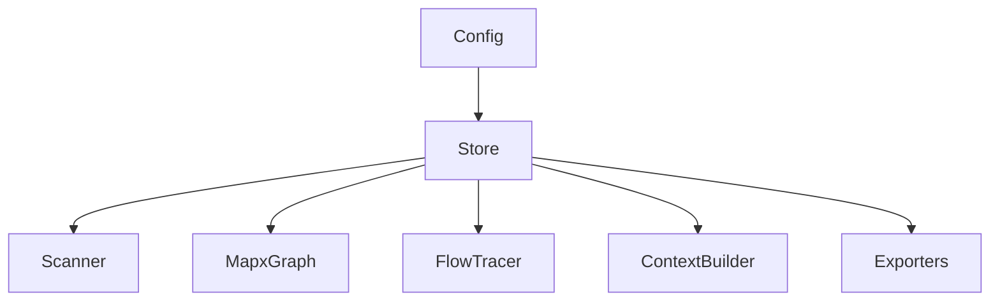

# Programmatic Usage

MapX is built in TypeScript and fully exposes its internal APIs, allowing you to embed code-graph scanning, data-flow tracing, custom querying, and token-budgeted LLM context generation directly inside your own Node.js or TypeScript applications.

> [!IMPORTANT]
> **ESM-Only Package**
> MapX is packaged as a pure ES Module (ESM). In Node.js projects importing MapX programmatically, ensure you set `"type": "module"` in your consumer application's `package.json` to allow correct module resolution.

---

## Architecture Overview

When using MapX programmatically, you will primarily interact with the following core modules:



- **`Config`**: Loads settings from `.mapx/config.json` (such as ignore lists, graph exclusion patterns, etc.).
- **`Store`**: Handles SQLite database transactions, read/write queries for files, symbols, dependency edges, snapshots, and metrics.
- **`Scanner`**: Discovers files, coordinates parallel worker parsing, invokes AST tree-sitter parsers, and syncs symbols into the `Store`.
- **`MapxGraph`**: Represents the in-memory, directed graphology graph. Used for PageRank evaluation, centrality, and topological traversal.
- **`FlowTracer`**: Traces downstream (callee) and upstream (caller) data flow paths starting from a file or symbol.
- **`ContextBuilder`**: Extracts task keywords, traverses related components, and builds token-budgeted Markdown context for LLMs.
- **`Exporters`**: Formats and packages graph metadata into text, JSON, DOT, SVG, or TOON format.

---

## 1. Load Configuration (`Config`)

The `Config` class handles reading the configuration from `.mapx/config.json` or fallback paths.

```typescript
import { Config } from '@mgamil/mapx';

const repoRoot = '/path/to/my/project';
const config = await Config.load(repoRoot);

console.log(`Repository Name: ${config.repo.name}`);
console.log(`Exclude Patterns: ${config.excludePatterns}`);
console.log(`Graph Excludes: ${config.graphExcludePatterns}`);
```

---

## 2. Database Store (`Store`)

The `Store` class wraps the local SQLite database. It provides clean read/write accessors for files, symbols, dependency edges, and repository metadata.

### Initialization

```typescript
import { Store } from '@mgamil/mapx';

// Opens or creates the SQLite file database. Supports ':memory:' for tests.
const store = new Store('/path/to/my/project/.mapx/mapx.db');

// Always close the database connection when done to release file locks
store.close();
```

### Common Read Methods

```typescript
// Count files and symbols
const fileCount = store.getFileCount();
const symbolCount = store.getSymbolCount();

// Fetch all scanned files
const files = store.getAllFiles(); // array of File objects

// Fetch all extracted symbols
const symbols = store.getAllSymbols(); // array of Symbol objects

// Get files by path
const file = store.getFile('src/core/scanner.ts');

// Query symbol by name (with namespace support)
const sym = store.getSymbolByName('Scanner::scanFull');

// Advanced search with filters
const results = store.searchSymbolsFiltered({
  query: 'Service',
  kind: 'class',
  limit: 20
});
```

---

## 3. Running Scans (`Scanner`)

The `Scanner` orchestrates the file scanning pipeline. It checks file changes using a fast content hash or Git tracking, parses source code using parallel worker threads, and persists findings to the `Store`.

```typescript
import { Scanner, Config, Store, MapxGraph } from '@mgamil/mapx';

const dir = '/path/to/project';
const config = await Config.load(dir);
const store = new Store(`${dir}/.mapx/mapx.db`);
const graph = new MapxGraph(config.repo.name);

// Optional progress callback
const onProgress = (current: number, total: number, file: string) => {
  console.log(`[${current}/${total}] Parsing: ${file}`);
};

const scanner = new Scanner(store, config, graph, onProgress, {
  parallel: true,           // Run parsers in parallel workers (default is true)
  excludes: [],             // Optional manual runtime overrides for excludes
  includes: []              // Optional manual runtime overrides for includes
});

// A. Full Scan (bypasses cache/force parses all files)
await scanner.scanFull(['my-repo'], { force: true });

// B. Incremental Scan (only parses modified/new files since last scan)
await scanner.scanIncremental();
```

---

## 4. In-Memory Code Graph (`MapxGraph`)

The `MapxGraph` class utilizes `graphology` under the hood. Populating it from the SQLite database enables graph metrics (like PageRank node importance and Leiden clustering).

### Populating the Graph

```typescript
import { MapxGraph, Store } from '@mgamil/mapx';

const store = new Store('.mapx/mapx.db');
const graph = new MapxGraph('my-repo-name');

// 1. Populate file nodes
for (const file of store.getAllFiles()) {
  graph.addFileNode(file.path, file.language, file.size_bytes, file.lines);
}

// 2. Populate symbol nodes
for (const sym of store.getAllSymbols()) {
  graph.addSymbolNode(
    sym.name,
    sym.file_path,
    sym.name,
    sym.kind,
    sym.start_line,
    sym.end_line,
    sym.scope
  );
}

// 3. Populate dependency edges
for (const edge of store.getAllEdges()) {
  graph.addDependencyEdge({
    sourceFile: edge.source_file,
    targetFile: edge.target_file,
    sourceSymbol: edge.source_symbol,
    targetSymbol: edge.target_symbol,
    edgeType: edge.edge_type,
    repo: edge.repo,
    weight: edge.weight,
    verifiability: edge.verifiability,
    targetRepo: edge.target_repo
  });
}
```

### Computing Importance Metrics (PageRank)

```typescript
// Compute PageRank centrality scores for all nodes in the graph
const pagerankScores = graph.computePageRank();

// Fetch files sorted by PageRank score (descending)
const rankedFiles = graph.getRankedFiles();
for (const file of rankedFiles.slice(0, 5)) {
  console.log(`${file.path} [Rank: ${file.pagerank.toFixed(4)}]`);
}
```

---

## 5. Data Flow Tracing (`FlowTracer`)

The `FlowTracer` traverses the dependency graph to map data flow, caller hierarchies, and downstream impacts.

```typescript
import { FlowTracer, Store } from '@mgamil/mapx';

const store = new Store('.mapx/mapx.db');
const tracer = new FlowTracer(store);

// Trace who calls a target symbol (Upstream)
const callersResult = tracer.trace({
  startSymbol: 'UserService::deleteUser',
  direction: 'up',
  maxDepth: 3,
  includeStructural: true
});

// Trace functions and files called by a target symbol (Downstream)
const calleesResult = tracer.trace({
  startSymbol: 'UserService::deleteUser',
  direction: 'down',
  maxDepth: 3,
  includeStructural: false
});

console.log(`Found ${callersResult.paths.length} upstream caller pathways.`);
```

---

## 6. Smart Context Builder (`ContextBuilder`)

The `ContextBuilder` selects matching files and symbols dynamically to compile optimal prompt context based on a natural language task description and token limit.

```typescript
import { ContextBuilder, Store, MapxGraph } from '@mgamil/mapx';

const store = new Store('.mapx/mapx.db');
const graph = new MapxGraph('my-repo');
// (assume graph is populated with nodes and edges)

const builder = new ContextBuilder(store, graph);

const result = await builder.buildContext({
  task: 'Fix database connection timeout handling during replication',
  tokens: 4096, // Maximum target token count
  depth: 2      // Graph traversal search depth
});

console.log('Included Files:', result.includedFiles.map(f => f.path));
console.log('Excluded Files (budget limit reached):', result.excludedFiles);
console.log('Estimated Token Usage:', result.estimatedTokens);
```

---

## 7. Graph Exporters (`Exporters`)

Exporters format the structural data inside the graph and database into various representations.

```typescript
import { LLMExporter, DotExporter, Store, MapxGraph } from '@mgamil/mapx';

const store = new Store('.mapx/mapx.db');
const graph = new MapxGraph('my-repo');
// (assume graph is populated with nodes and edges)

// 1. LLM Exporter: Generates a highly compact Markdown summary for LLMs
const llmExporter = new LLMExporter(store, graph);
const llmMarkdown = llmExporter.export({ tokenBudget: 8192 });

// 2. DOT Exporter: Generates GraphViz representation for diagram visualizations
const dotExporter = new DotExporter(store, graph);
const dotGraph = dotExporter.export({ cluster: 'directory', depth: 3 });
```

---

## Complete E2E Integration Example

Here is a full TypeScript script demonstrating loading, scanning, metric analysis, data tracing, and LLM context extraction programmatically:

```typescript
import { resolve } from 'node:path';
import { 
  Config, 
  Store, 
  Scanner, 
  MapxGraph, 
  FlowTracer, 
  ContextBuilder, 
  LLMExporter 
} from '@mgamil/mapx';

async function main() {
  const dir = resolve('./my-project');
  
  // 1. Load configuration and open store
  const config = await Config.load(dir);
  const store = new Store(resolve(dir, '.mapx/mapx.db'));
  const graph = new MapxGraph(config.repo.name);

  // Ensure DB connection is closed on shutdown
  process.on('exit', () => store.close());

  // 2. Perform an incremental scan of changes
  console.log('Scanning codebase...');
  const scanner = new Scanner(store, config, graph);
  const scanResult = await scanner.scanIncremental();
  console.log(`Scan completed: Parsed ${scanResult.parsedFiles} files.`);

  // 3. Load graph nodes/edges into memory to enable graph calculations
  console.log('Populating in-memory graph...');
  for (const file of store.getAllFiles()) {
    graph.addFileNode(file.path, file.language, file.size_bytes, file.lines);
  }
  for (const sym of store.getAllSymbols()) {
    graph.addSymbolNode(sym.name, sym.file_path, sym.name, sym.kind as any, sym.start_line, sym.end_line, sym.scope);
  }
  for (const edge of store.getAllEdges()) {
    graph.addDependencyEdge({
      sourceFile: edge.source_file,
      targetFile: edge.target_file,
      sourceSymbol: edge.source_symbol,
      targetSymbol: edge.target_symbol,
      edgeType: edge.edge_type as any,
      repo: edge.repo,
      weight: edge.weight,
      verifiability: edge.verifiability as any,
      targetRepo: edge.target_repo
    });
  }

  // 4. Print the top 3 most important files (via PageRank)
  console.log('\n--- Core Architecture Files ---');
  const ranked = graph.getRankedFiles();
  for (const file of ranked.slice(0, 3)) {
    console.log(`- ${file.path} (Importance Score: ${file.pagerank.toFixed(5)})`);
  }

  // 5. Trace dependency blast radius for a symbol
  console.log('\n--- Downstream Data Flow Trace ---');
  const tracer = new FlowTracer(store);
  const trace = tracer.trace({
    startSymbol: 'UserService',
    direction: 'down',
    maxDepth: 2,
    includeStructural: true
  });
  console.log(`Flow paths downstream of UserService: ${trace.paths.length}`);

  // 6. Build prompt context for LLM agent interaction
  console.log('\n--- Building Agent Context ---');
  const contextBuilder = new ContextBuilder(store, graph);
  const context = await contextBuilder.buildContext({
    task: 'Add transaction support to UserService methods',
    tokens: 4000
  });
  console.log(`Context built successfully. Estimated tokens: ${context.estimatedTokens}`);
}

main().catch(console.error);
```
