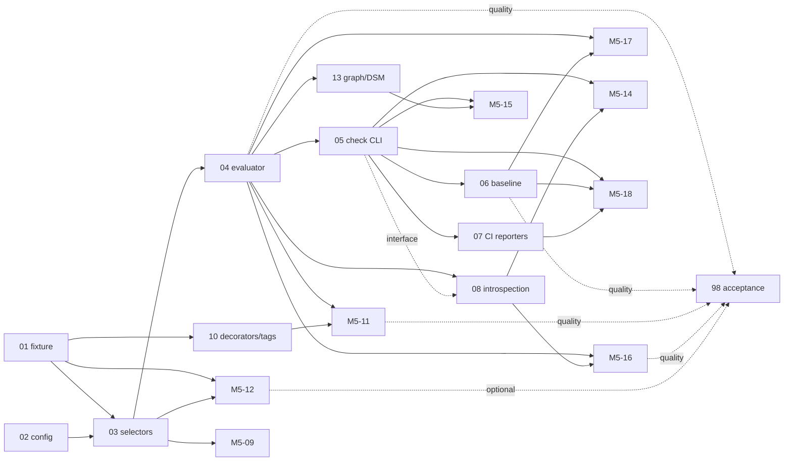

# Plan draft: milestone M5, Architecture rules (Deptrac-inspired)

Status: **revision 2, merged 2026-10-31 (D013).** The 19 tasks and 23 requirements from [05-requirements.md](05-requirements.md) now live in `docs/baton/TASKS.json` and `REQUIREMENTS.json`, which are authoritative; this document is the design record. Reconciliation against `develop@8b933e1` added three interface dependencies not in the draft graph below: M5-10 → M3-04, M5-12 → M4-03, M5-18 → M4-01 (see §3).

Effort: **183 h expected** (min 146, max 252). At the plan's 20 h/week capacity that is about 9 weeks of one engineer. The MUST set alone (Phase A plus the M5-16 regression guard) is about 65 h.

## 1. Phases

| Phase | Tasks | Delivers | Expected hours |
|---|---|---|---|
| **A. Engine and CI gate** | M5-01 fixture → M5-02 config → M5-03 selectors → M5-04 evaluator → M5-05 `mapx check` → M5-06 baseline/`--compare` | A usable Deptrac-equivalent for path, name, role, cluster and repo layers in all languages, with CI exit codes | 57 |
| **B. Surfaces** | M5-07 CI reporters, M5-08 introspection, M5-13 graph/DSM, M5-14 MCP | SARIF, GitHub, GitLab; debug commands; diagrams; agent pre-flight | 30 |
| **C. Ecosystem depth** | M5-09 hierarchy, M5-10 decorators/doc tags, M5-11 visibility, M5-12 externals (epic) | Deptrac's remaining collectors (`extends`, `attribute`, `tagValueRegex`, `composer`, `php_internal`, `superglobal`, `private`/`@internal`) in every ecosystem | 56 |
| **D. Experience** | M5-15 dashboard, M5-16 smells, M5-17 `arch init` and presets, M5-18 dogfood and docs, M5-98 acceptance | Visual exploration, health smells, a one-command start, MapX enforcing its own architecture | 40 |

Phase A alone is already a useful release slice. B and C can run in either order. M5-12 is an **epic**: decompose it per ecosystem (npm, Composer, pip, Go) into 4–16 h iterations before starting.

## 2. Dependency graph



Critical path inside M5: M5-01 → M5-03 → M5-04 → M5-05 → M5-08 → M5-16 → M5-98 (62 h). If M5 is merged with no other change, **it becomes the plan's critical path** (M3's remaining path is 32 h). The owner should decide the ordering against M3 and M4 (see the README's open decisions).

## 3. Sequencing against the other agent's work

The other agent currently has uncommitted changes in `src/cli.ts`, `src/core/scanner.ts`, `src/exporters/llm-exporter.ts` and a new `src/core/relations.ts`.

- **No conflict:** M5-01 and M5-02, and M5-03/M5-04 apart from reads. They live in new `src/arch/`, `tests/` and `schemas/` paths.
- **Touches `cli.ts`:** M5-05, M5-06, M5-08, M5-17. These are small registration edits; schedule them after the current work is committed.
- **Touches `scanner.ts` and `store.ts`:** M5-12 only. It is the highest-risk task; keep it in the same owner's queue as any scanner work (M4-03, M4-04) to avoid parallel edits.
- **Touches parsers:** M5-10. Coordinate with the M3 Vue SFC work, which also changes TS/JS extraction.

## 4. Fixture-first notes (D004)

M5-01 sets the 0.0 baseline. Every later task's acceptance criteria are stated as fixture recall and precision per finding kind. Each fixture row names its rule, so `score-arch.ts` can attribute a regression to a rule. Per the ground rules, fixtures are synthetic: no private or pilot code.

## 5. How the draft was validated before merging (historical)

```ts
// npx tsx validate-draft.ts <draft.json>   — the draft is merged now; `npm run plan:validate` is the live check
import { readFileSync } from 'node:fs';
import { validate } from './scripts/baton/model.ts';
const plan = JSON.parse(readFileSync('docs/baton/TASKS.json', 'utf8'));
const reqDoc = JSON.parse(readFileSync('docs/baton/REQUIREMENTS.json', 'utf8'));
const draft = JSON.parse(readFileSync(process.argv[2], 'utf8'));
plan.milestones.push(draft.milestone);
plan.tasks.push(...draft.tasks);
validate(plan, [...(reqDoc.requirements ?? reqDoc), ...draft.requirements]);
```

## 6. Retrofit checklist (applied 2026-10-31, D013)

1. Move the research pack to `docs/research/deptrac/`, the path the task `sources` cite.
2. Record owner decisions as new `D0xx` entries in `docs/baton/DECISIONS.md` (adopting M5, its order relative to M3 and M4, the config file name, and the exit codes).
3. Append the milestone, tasks and requirements to TASKS.json and REQUIREMENTS.json. Use the BATON tooling where it supports adds; otherwise make a careful JSON edit and run `npm run plan:validate`.
4. Write `docs/baton/iterations/M5-01.md` … for at least the first wave (M5-01, M5-02).
5. `npm run plan:report` to regenerate CRITICAL_PATH, DEPENDENCIES and MASTER_ROADMAP.
6. Add the RISKS entries: scanner contention (M5-12), and UI coverage (R06 extended to the Architecture view).
7. Do **not** touch `specs/` (D001). New design references live under `docs/research/`.
